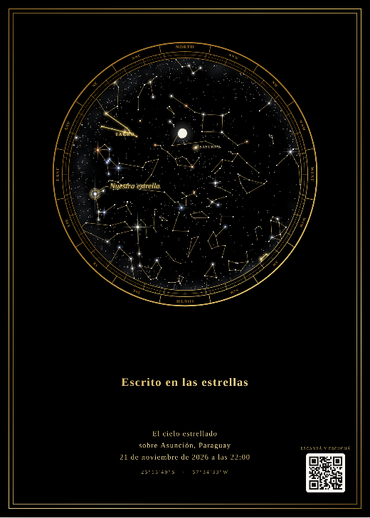
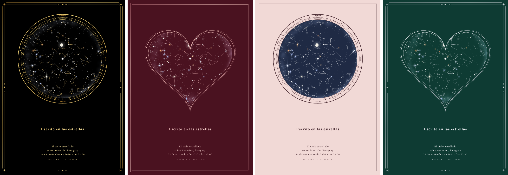

# ✨ Mapa de las estrellas

Generador **gratuito** de pósters con el cielo estrellado de una fecha y un lugar especiales:
el día que se conocieron, un aniversario, un nacimiento…

Todo funciona en tu navegador, sin instalar nada y sin enviar tus datos a ningún lado.

## Cómo usarlo

### 👉 [Abrir el generador online](https://eddevita.github.io/mapa-estrellas/)

1. Entrá al link de arriba desde la compu o el celular.
2. Elegí el lugar, la fecha, la hora y personalizá el diseño.
3. Tocá **"Descargar imagen en alta resolución"**: baja un PNG a 300 dpi listo para imprimir.

¿Lo querés usar sin internet? Descargá el archivo **`index.html`** (botón ↓ *Download raw file*)
y abrilo con doble clic. Sin conexión funciona igual, solo cambia la tipografía.

## Qué se puede personalizar

- **Cielo real** para cualquier fecha, hora y lugar (estrellas brillantes, constelaciones, Luna con su fase y planetas)
- **8 colores** de póster y detalles en **dorado, plateado u oro rosa**
- **Forma** del mapa: círculo o corazón · **Marco** doble, simple u ornamental
- **Vía Láctea**, brillo y color real de las estrellas, nombres de constelaciones, meridianos
- **Dedicatoria** que se ajusta sola · título · 4 tipografías
- **Bautizar una estrella** con un nombre · resaltar **signos zodiacales**
- **Código QR** hacia una canción, video o mensaje de voz
- **Dos cielos** en un mismo póster (antes y ahora)
- **Formatos**: 50×70, 50×75, A3, 30×40 y 40×50 cm, a 300 dpi
- **Vista previa** del póster colgado en la pared

## Consejos para imprimir

- Mandá el PNG a la imprenta **como archivo** (correo, pendrive o WhatsApp como *documento*), nunca como foto.
- Pedí **tamaño real, sin escalar**, en papel fotográfico mate o semimate.

## Sobre la precisión

Las estrellas brillantes, las constelaciones, la Luna y los planetas se calculan en su posición real.
Las estrellitas más débiles del fondo son decorativas.

## Licencia

Este proyecto está bajo la licencia **Creative Commons Atribución-NoComercial 4.0** ([ver LICENSE](LICENSE)):

- ✅ Podés usarlo gratis, compartirlo y modificarlo, dando crédito al autor.
- ✅ Los pósters que generes para vos o para regalar son tuyos.
- ❌ No está permitido venderlo ni usarlo para cobrar por pósters como negocio.

Incluye el generador de QR de Kazuhiko Arase (licencia MIT). "QR Code" es marca registrada de DENSO WAVE INCORPORATED.
Tipografías de Google Fonts (SIL Open Font License).
